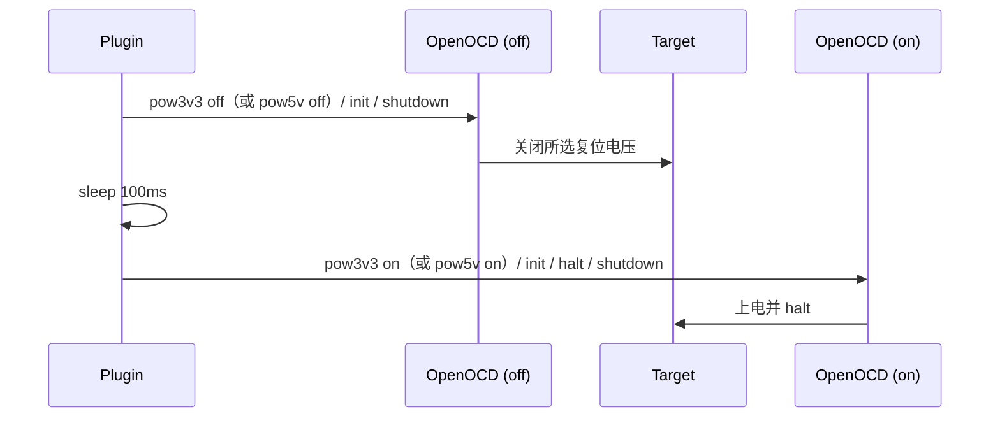

# 方案 A：用 OpenOCD 实现掉电复位

## 0. 目标与边界

目标：

- 在插件中增加“掉电复位”能力；
- 复位过程为：关闭 WCH-Link 复位电压 → 延时 → 打开复位电压 → 重新连接/暂停；
- 不引入原生 DLL、koffi 或额外硬件依赖；
- 默认仍保留 NRST 复位，掉电复位作为可选项。

非目标：

- 不修改 MRS 本体；
- 不实现“调试会话中随时掉电复位”的透明恢复；
- 不替代 WCH-Link 原生下载器；
- 不处理外部独立供电目标的电源切换。

前提：

- 目标板由 WCH-Link 的 3.3V 或 5V 输出供电；
- 使用的 OpenOCD 是 MRS 自带版本，支持 `pow3v3`、`pow5v` 命令；
- 插件已经有 `resolveOpenOcdPaths()`、`resolveConfiguredOpenOcdExecutable()` 等路径解析能力。

---

## 1. 当前插件的复位点

| 场景       | 当前实现                        | 复位方式                   |
| ---------- | ------------------------------- | -------------------------- |
| 下载       | `program ... verify reset exit` | OpenOCD `reset`，NRST      |
| 调试启动   | `-c init -c halt`               | OpenOCD 初始化，NRST       |
| 调试中重置 | GDB `monitor reset halt`        | OpenOCD `reset halt`，NRST |
| 调试断开   | `monitor reset halt` + resume   | NRST                       |

所以“默认是 NRST 复位”是准确的。

---

## 2. 为什么必须分两次 OpenOCD

MRS 自带 OpenOCD 的 WCH-Link 驱动提供：

```text
pow3v3 ('on'|'off')
pow5v  ('on'|'off')
```

这两个都是 **configuration command**，只能在 `init` 之前使用。

关键点：`pow3v3` 和 `pow5v` **共用同一个电源状态**，后一条命令会覆盖前一条。实测：

```text
pow3v3 off + pow5v off  → 日志只有 POWER 5V DISABLE，3.3V 仍然有电
pow5v off + pow3v3 off  → 日志只有 POWER 3V3 DISABLE，目标断电
```

因此必须只发送目标实际使用的那一路，不能同时发送两条。

实际动作发生在 `wlink_init` 中：

```text
pow3v3 off 或 pow5v off → 记录 _iocontrol / _powstat
init                     → wlink_init 执行对应的电源关闭
```

同时：

- 不能在同一个 OpenOCD 进程里先 `off` 再 `on`；
- 连续写 `off` 再 `on`，只有最后一次状态会在 `init` 时生效；
- `init` 只能执行一次；
- 要实现“关 → 等 → 开”，必须启动两个 OpenOCD 进程。



---

## 3. 命令序列

### 3.1 公共参数

两次调用使用同一套基础参数：

```text
-f <wch-riscv.cfg>
-c "chip_id <mcuType>"
-c "dbgtool"
```

如果工程使用 2-wire：

```text
-c "two_wires"
```

必须在 `init` 之前。

可选：

```text
-s <OpenOCD bin 目录>
```

### 3.2 断电

```bat
openocd.exe ^
  -f "<wch-riscv.cfg>" ^
  -c "chip_id <mcuType>" ^
  -c "dbgtool" ^
  -c "pow3v3 off" ^
  -c "init" ^
  -c "shutdown"
```

如果目标板使用 5V 供电，把 `pow3v3 off` 换成 `pow5v off`。不要同时发送两条。

### 3.3 延时

```text
由 wchVscode.powerOffDelayMs 控制，默认 100 ms，范围 0–10000 ms
```

如果目标板电容较大，可配置到 500 ms 或 1000 ms。

### 3.4 上电

```bat
openocd.exe ^
  -f "<wch-riscv.cfg>" ^
  -c "chip_id <mcuType>" ^
  -c "dbgtool" ^
  -c "pow3v3 on" ^
  -c "init" ^
  -c "halt" ^
  -c "shutdown"
```

如果目标板使用 5V 供电，把 `pow3v3 on` 换成 `pow5v on`。

说明：

- 上电本身就是一次复位；
- `halt` 让 CPU 停住，方便调试器随后连接；
- 如果只想复位后运行，把 `halt` 去掉；
- `shutdown` 保证 OpenOCD 在完成动作后退出。

### 3.5 参数顺序

顺序很重要：

```text
-f / configOptions
chip_id
dbgtool
two_wires（如果需要）
pow3v3 off|on（或 pow5v off|on，二选一）
init
halt（仅上电）
shutdown
```

`pow3v3` / `pow5v` 必须在 `init` 之前；`two_wires` 也必须在 `init` 之前。两条电源命令不能同时出现。

---

## 4. 插件集成设计

### 4.1 新增设置

新增三个 VS Code 设置，并在“设置与工具”侧栏中显示当前值：

```json
{
  "wchVscode.resetMode": "nrst",
  "wchVscode.powerOutput": "3v3",
  "wchVscode.powerOffDelayMs": 100
}
```

`wchVscode.resetMode` 可选值：

```text
nrst       // 默认，保持现有行为
powerOff   // 下载/调试启动前执行掉电复位
```

`wchVscode.powerOutput` 可选值：

```text
3v3   // 默认，切换 WCH-Link 的 3.3V 输出
5v    // 切换 WCH-Link 的 5V 输出
```

`wchVscode.powerOffDelayMs`：

- 单位毫秒，默认 100；
- 范围 0–10000；
- 表示关闭电源后等待多久再重新上电。

### 4.2 新增命令

新增：

```text
wchVscode.powerOffReset
```

命令行为：

1. 解析当前工程；
2. 解析 OpenOCD 路径和 cfg；
3. 执行断电；
4. 延时；
5. 执行上电；
6. 输出日志；
7. 失败时提示用户，并建议回退到 NRST。

### 4.3 核心函数

伪代码：

```ts
type ResetMode = "nrst" | "powerOff";

async function powerOffReset(
  project: ResolvedBuildProject,
  options: { halt: boolean },
): Promise<void> {
  const paths = resolveOpenOcdPaths(getConfiguredMounRiverStudioPath());
  if (!paths) throw new Error("MRS path not configured");
  const powerOutput = getPowerOutput();

  await runPowerPass(project, paths, "off", false, powerOutput);
  await delay(getPowerOffDelayMs());
  await runPowerPass(project, paths, "on", options.halt, powerOutput);
}

async function runPowerPass(
  project: ResolvedBuildProject,
  paths: ResolvedOpenOcdPaths,
  state: "off" | "on",
  halt: boolean,
  powerOutput: "3v3" | "5v",
): Promise<void> {
  const args = buildPowerPassArgs(project, paths, state, halt, powerOutput);
  await spawnAndWait(paths.executable, args, {
    cwd: path.dirname(paths.executable),
    timeoutMs: 15000,
  });
}
```

### 4.4 参数构造

```ts
function buildPowerPassArgs(
  project: ResolvedBuildProject,
  paths: ResolvedOpenOcdPaths,
  state: "off" | "on",
  halt: boolean,
  powerOutput: "3v3" | "5v",
): string[] {
  // 固定使用 MRS 默认配置，避免 configOptions 里的 init 排在电源命令前面。
  // 只做电源切换，禁用 GDB/Telnet/Tcl 端口，避免端口占用。
  const args: string[] = [
    "-c",
    "gdb_port disabled",
    "-c",
    "telnet_port disabled",
    "-c",
    "tcl_port disabled",
    "-f",
    paths.config,
  ];

  appendOpenOcdChipIdArgs(args, project.model.flash.mcuType);
  appendOpenOcdCommandArg(args, "dbgtool");

  if (
    project.model.flash.debugInterfaceMode === TWO_WIRE_DEBUG_INTERFACE_MODE
  ) {
    appendOpenOcdCommandArg(args, "two_wires");
  }

  // pow3v3 与 pow5v 共用同一个电源状态，后一条会覆盖前一条。
  const powerCommand = powerOutput === "5v" ? "pow5v" : "pow3v3";
  args.push("-c", `${powerCommand} ${state}`);

  appendOpenOcdCommandArg(args, "init");
  if (state === "on" && halt) {
    appendOpenOcdCommandArg(args, "halt");
  }
  appendOpenOcdCommandArg(args, "shutdown");
  return args;
}
```

### 4.5 `configOptions` 的注意点

下载和调试路径仍使用工程里的 `openOcdConfigOptions`；掉电复位路径单独处理：

```ts
const args = ["-f", paths.config];
```

原因：

- 典型工程的 `configOptions` 是：

  ```json
  ["-f \"${WCH:OpenOCD:default}/bin/wch-riscv.cfg\""]
  ```

- 如果某个工程的 `configOptions` 已经包含 `-c init`，把 `pow3v3`/`pow5v` 追加在它后面会排在 `init` 之后，失效；
- 掉电复位固定使用 MRS 默认 `wch-riscv.cfg`，可以保证电源命令一定在 `init` 之前；
- 2-wire 工程仍会根据 `debugInterfaceMode` 自动追加 `two_wires`。

如果后续需要支持完全自定义的 OpenOCD 配置，可以再增加“解析 `configOptions` 并在 `init` 前插入命令”的逻辑。

### 4.6 下载流程集成

当前下载命令：

```text
program "<file>" verify reset exit
```

`reset` 是 NRST。切换到掉电复位后，流程必须是：

```text
build
  → powerOffProject()              // 只关闭电源并等待，不重新上电
  → 同一个 OpenOCD 进程：
       pow3v3 on
       init
       halt
       program ... verify reset exit
```

关键点：**上电和下载必须在同一个 OpenOCD 会话里**，不能先跑一个“上电 + halt + shutdown”的进程，再跑下载进程。

原因：

- `shutdown` 会释放目标，CPU 可能在两个进程之间恢复运行；
- 如果应用启动后重新复用调试引脚，第二个 OpenOCD 可能无法再进入下载模式；
- 在同一个会话里 `pow3v3 on` → `init` → `halt` → `program`，CPU 没有运行窗口。

为什么下载后不再执行掉电复位：

- 下载完成后只需要让新固件运行，`program ... reset exit` 的 NRST 已经足够；
- 再执行一次掉电复位会让日志看起来像“下载执行了两次”，也会增加等待时间。

### 4.7 调试流程集成

调试启动同样必须把“上电”和“调试 OpenOCD”合并：

```text
powerOffProject()
  → 启动调试会话
  → 调试 OpenOCD：
       pow3v3 on
       init
       halt
  → GDB 连接
```

如果先单独执行“上电 + halt + shutdown”，再启动调试 OpenOCD，中间同样存在 CPU 运行窗口，可能重新关闭调试接口。

不要在调试会话运行中让 OpenOCD 自己掉电复位，因为：

- 掉电会断开 GDB/OpenOCD 连接；
- OpenOCD 需要重新 `init`；
- 当前调试适配器没有“断线重连”的状态机。

### 4.8 调试中的 reset 请求

当前 DAP 的 `restart` / reset 走：

```text
monitor reset halt
```

这是 NRST。掉电复位无法通过 GDB monitor 在同一次 OpenOCD 会话中完成。

可选策略：

- 保留 NRST 作为会话内 reset；
- 掉电复位只用于启动前/下载后；
- 如果确实需要会话内掉电复位，必须先停止调试会话，再执行 `powerOffReset()`，然后重新启动调试。

---

## 5. 错误处理

### 5.1 断电阶段可能返回非 0

目标断电后，OpenOCD 的 `init` 可能因为目标无响应而失败：

```text
Error: ...
```

但所选电源的关闭命令已经执行。

处理建议：

- 断电阶段允许非 0 退出；
- 检查输出中是否包含命令不存在、WLink Open Error 等真正错误；
- 如果只是 target 无法连接，视为预期。

### 5.2 上电阶段必须成功

上电阶段应满足：

- 所选电源的开启命令执行成功；
- `init` 成功；
- `halt` 成功（如果使用 `halt`）。

否则提示用户：

```text
Power-off reset failed: <OpenOCD output>
```

### 5.3 常见错误

| 现象                                    | 原因                                     | 处理                                                                |
| --------------------------------------- | ---------------------------------------- | ------------------------------------------------------------------- |
| `invalid command name "pow3v3"`         | OpenOCD 版本不支持                       | 回退 NRST，或升级 MRS OpenOCD                                       |
| `WLink Open Error`                      | WCH-Link 未连接/被占用                   | 检查连接，关闭其他调试会话                                          |
| 上电后无法连接                          | 目标未上电/电源不足                      | 检查 3.3V/5V、电流、接线                                            |
| 目标一直不复位                          | 目标外部供电                             | 掉电复位不适用，改用 NRST 或外部电源控制                            |
| 目标 LED 一直亮，没有断电               | `powerOutput` 选错，切换了未使用的那一路 | 3.3V 供电选 `3v3`，5V 供电选 `5v`；不要同时发送 `pow3v3` 和 `pow5v` |
| `init` 超时                             | 目标启动慢/电容大                        | 增大延时                                                            |
| `unknown WCH-LINK` / `WLink Open Error` | WCH-Link 关闭电源后尚未重新枚举完成      | 自动等待 500 ms 后重试，最多 2 次；仍失败时检查连接                 |
| `shutdown` 前进程挂起                   | `init` 失败但未退出                      | 设置 15s 超时并 kill                                                |

### 5.4 超时

每次 OpenOCD 调用：

```text
15 秒超时
```

超时后：

- 终止子进程；
- 输出日志；
- 提示用户检查 WCH-Link 和目标供电。

---

## 6. 日志建议

建议记录：

```text
[power-off reset] method=powerOff
[power-off reset] openocd=<path>
[power-off reset] off args=<args>
[power-off reset] off exit=<code>
[power-off reset] delay=100ms
[power-off reset] on args=<args>
[power-off reset] on exit=<code>
[power-off reset] result=success|failed
```

不要只记录“成功/失败”，要保留 OpenOCD 原始输出，方便排查。

下载和掉电复位共用“WCH 下载/复位”终端。复位开始前就显示：

```text
开始下载：<projectName>
开始掉电复位：<projectName>
正在关闭 3.3V 复位电源...
[off] POWER 3V3 DISABLE
等待 100 ms 后重新上电
电源已关闭，准备上电并继续操作。
...
下载完成。
```

这样下载或手动复位点击后不会看起来无响应，也不需要单独打开一个复位终端。

---

## 7. 测试计划

### 7.1 默认 NRST 回归

- `wchVscode.resetMode = "nrst"`；
- 下载、调试启动、调试 reset 均保持现有行为；
- 不产生额外 OpenOCD 进程。

### 7.2 掉电复位：WCH-Link 供电

- 目标板仅由 WCH-Link 供电；
- `resetMode = "powerOff"`；
- `powerOutput` 与目标板供电一致（3.3V 或 5V）；
- 执行 `wchVscode.powerOffReset`；
- 观察目标电源指示灯灭 → 亮；
- OpenOCD 日志只出现所选电源的 `DISABLE` / `ENABLE`，不应同时出现 3V3 和 5V；
- 调试可以正常连接。

### 7.3 掉电复位：外部供电

- 目标板外部供电；
- 执行掉电复位；
- 目标不会断电，复位不会发生；
- 文档/提示应明确说明该限制。

### 7.4 2-wire 工程

- `debugInterfaceMode = "2-wires serial"`；
- 断电/上电两次调用都带 `-c two_wires`；
- 复位后仍能连接。

### 7.5 掉电复位进入下载模式

- 下载前执行 `powerOffProject()`，只关闭电源并等待；
- 下载 OpenOCD 会话中先 `pow3v3 on`，再 `init`、`halt`、`program ... verify reset exit`；
- 上电和下载必须在同一个 OpenOCD 进程内完成；
- 下载完成后由 NRST reset 运行，不再执行第二次掉电复位；
- 验证固件正常运行，日志中只出现一次掉电复位流程。

### 7.6 不支持 `pow3v3` 的 OpenOCD

- 使用旧版 OpenOCD；
- 命令报 `invalid command name`；
- 插件提示回退 NRST，不崩溃。

---

## 8. 限制与风险

1. **只对 WCH-Link 供电的目标有效**。外部供电时，`pow3v3` / `pow5v` 关不掉目标电源。
2. **`pow3v3` 和 `pow5v` 共用同一个电源状态**。同时发送时后一条覆盖前一条，必须只发送目标实际使用的那一路；如果目标同时使用 3.3V 和 5V，当前 OpenOCD 命令无法同时关闭两路。
3. **关→开必须分成两个 OpenOCD 进程**，但“上电”和“下载/调试”必须在同一个会话里完成。否则 `shutdown` 后 CPU 可能运行，重新关闭调试接口。
4. **调试会话内 reset 仍是 NRST**。掉电复位会断开连接，不适合透明重连。
5. **`pow3v3` / `pow5v` 是配置命令**，不是运行时命令。
6. **`init` 在断电阶段可能失败**，这是预期行为，需要区分“目标无响应”和“命令不存在”。
7. **不同 WCH-Link 型号的电源控制能力不同**。CH549、WCH-LinkE、WCH-LinkW 的支持程度可能不同，需要实测。
8. **目标板电容较大时需要更长延时**。可通过 `wchVscode.powerOffDelayMs` 调整，默认 100 ms。
9. **2-wire 工程要确保两次调用都带 `two_wires`**，否则第二次可能以 1-wire 初始化。
10. **下载完成后不要再执行一次掉电复位**。此时芯片已经在下载模式，`program ... reset exit` 的 NRST 复位即可运行固件。
11. **不要在调试会话运行中直接掉电**，否则 GDB/OpenOCD 会掉线。

---

## 9. 结论

方案 A 的推荐落地方式：

```text
默认 resetMode = nrst
  → 保持现有下载/调试行为

用户选择 resetMode = powerOff
  → 下载：先 powerOffProject() 关闭电源，
          再在同一个 OpenOCD 进程里 pow3v3 on + init + halt
          + program ... verify reset exit
  → 调试：先 powerOffProject()，调试 OpenOCD 启动时 pow3v3 on + init + halt
  → 会话内 reset：仍使用 NRST
```

核心命令（实际实现会禁用未使用的 GDB/Telnet/Tcl 端口）：

```text
断电（3.3V 板）：
  -c "gdb_port disabled" -c "telnet_port disabled" -c "tcl_port disabled"
  -f wch-riscv.cfg -c "chip_id <mcu>" -c dbgtool
  -c "pow3v3 off" -c init -c shutdown

上电（3.3V 板）：
  -c "gdb_port disabled" -c "telnet_port disabled" -c "tcl_port disabled"
  -f wch-riscv.cfg -c "chip_id <mcu>" -c dbgtool
  -c "pow3v3 on" -c init -c halt -c shutdown
```

5V 板把 `pow3v3` 换成 `pow5v`；不要同时发送两条电源命令。

这条路线不引入新依赖，复用现有 OpenOCD 路径，适合作为插件的第一版掉电复位实现。
